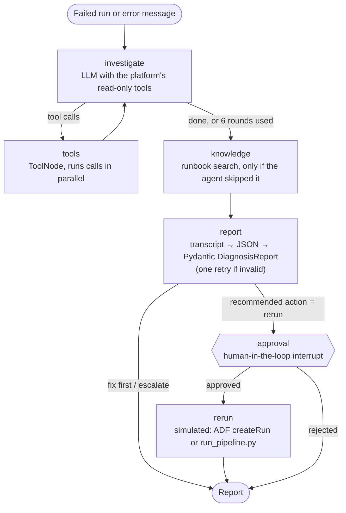

# Pipeline Incident Agent

An AI agent that investigates failed data pipeline runs the way an on-call data engineer would. It decides which systems to check, reads the evidence, finds the fix in the team's runbooks and past incidents, and writes a structured diagnosis. Reruns happen only after a human approves.

Built with **LangGraph**, **LangChain**, open-weight LLMs on **Groq** (OpenAI gpt-oss-120b), **hybrid search** (BM25 + Gemini embeddings) and **Streamlit**.

**🚀 Live demo: [pipeline-incident-agent.streamlit.app](https://pipeline-incident-agent.streamlit.app/)**: choose a platform, pick a failed run, click **Diagnose**, and watch the agent investigate. When it recommends a rerun it asks you to approve first.

The agent works on two platforms:

| Platform | What it is | Failures |
|---|---|---|
| **Retail Analytics Lakehouse** (real run logs) | My [PySpark Medallion pipeline](https://github.com/piyush60629/Retail-Analytics-Lakehouse). Every run writes a structured run log and snapshots of its inputs and reports. | 5 real failed runs: the actual pipeline was run on a batch with a broken input (new column, text in a numeric column, duplicate orders, a truncated file, a run started from the wrong stage) |
| **Azure data platform** (synthetic) | An invented retail platform on Azure Data Factory, ADLS Gen2, Databricks and Snowflake | 12 synthetic incidents, each with a different root cause |

> The lakehouse runs on generated retail data; the Azure platform and its monitoring data are invented. No company data is used.

## The problem

When a pipeline fails at 2 AM, the on-call engineer has to read the error, open the run history, test connections, compare schemas, look at Spark metrics, search the runbooks and old incident tickets, and only then decide whether to rerun, fix something first, or call another team. Error messages rarely say the real cause: `Server failed to authenticate the request` does not tell you that a service principal secret expired last night.

## What the agent does

1. **Reads the failed run** (pipeline, activity, error code, linked services, upstream run).
2. **Chooses the evidence to collect** with tools: connection and credential status, run history, source schemas, Databricks job metrics, landing-zone files. It can call several tools in one round and follow leads, for example from a failed Gold pipeline to the upstream Silver run and then to that job's Spark metrics.
3. **Searches runbooks and past incidents** for the fix procedure.
4. **Writes a structured diagnosis**: category, root cause, confidence, evidence, fix steps, prevention, sources and a ticket-ready summary, validated against a Pydantic schema.
5. **Asks before acting**: if it recommends a rerun, the graph pauses (LangGraph `interrupt`) until a person approves or rejects. The model itself has no tool that can change anything.

## How it works



| Tool | What it checks | Typical failures |
|---|---|---|
| `get_pipeline_run` | Run details, error, linked services, upstream run id | Always first |
| `get_recent_runs` | History: durations, reruns, file names and MD5 hashes | Recurring or transient errors, duplicate files |
| `check_linked_service` | Credential expiry, connection test, IAM changes, runtime status, Snowflake quotas | Authentication, 403s, offline runtime, quota |
| `compare_source_schema` | Expected vs received columns, nullability changes, null rates | Schema drift, data quality |
| `get_job_metrics` | Databricks durations, task input sizes, skewed keys, Spark settings | Timeouts, out of memory |
| `check_landing_zone` | File arrival time, size, MD5, arrival SLA | Missing, late or duplicate files |
| `search_knowledge` | Runbooks and past incident reports (hybrid BM25 + vector search) | Fix procedures |

**Lakehouse tools** (read the real run logs in `lakehouse/monitoring/`):

| Tool | What it checks | Typical failures |
|---|---|---|
| `get_lakehouse_run` | Batch date, start stage, status and exit code per stage, root error under wrapper exceptions | Always first |
| `get_stage_log` | Key error lines (Spark `Caused by`) and the log tail of a stage | Unclear errors |
| `check_source_files` | Raw CSVs: manifest status, rows, rows with the wrong column count, last row, columns vs the Bronze schema, values that do not fit numeric types, duplicate keys | Schema drift, bad values, duplicates, truncated files |
| `get_layer_outputs` | Which Medallion layers exist for the batch, what each stage reads and writes, the safe stage to rerun from | Missing inputs, wrong `--start-from` |
| `get_validation_report`, `get_gold_quality` | Validation results and Gold data quality checks | Data quality |
| `get_recent_lakehouse_runs` | Recent batches and their status | New vs recurring |

For the lakehouse, an approved rerun proposes the exact command, for example `python run_pipeline.py --batch-date 2026-07-22` (the first stage whose output is missing, so a rerun never reads inputs that were never written).

## Evaluation

The agent is evaluated on all 17 incidents (`eval/cases.json`): 12 synthetic Azure incidents and 5 real lakehouse runs. Each case has the expected category, the acceptable actions, the evidence tools a good investigation must use, and a reference root cause.

| Metric | What it measures |
|---|---|
| Category accuracy | Predicted failure category matches the expected one |
| Recommended action correct | Rerun vs fix first vs escalate is appropriate |
| Evidence tool recall | Share of the required evidence tools the agent actually called |
| Root-cause score | An LLM judge from a different model family (Qwen 3.8) compares the root cause with the reference: 1 / 0.5 / 0 |
| Tool calls, seconds, step-budget rate | Efficiency, and how often the agent hit its 6-round limit |

<!-- EVAL_RESULTS_START -->
**Latest results**

- Run: 2026-10-21 03:31 UTC · 17 incidents · errors: 0  
- Agent: `openai/gpt-oss-120b` via groq · judge: `qwen/qwen3.8-27b`

| Metric | Score |
|---|---|
| Diagnosis completed | 100.0% |
| Category accuracy | 88.2% |
| Recommended action correct | 94.1% |
| Evidence tool recall | 97.1% |
| Root-cause score (LLM judge) | 94.1% |
| Avg tool calls per incident | 3.4706 |
| Avg seconds per incident | 32.1353 |
| Stopped by the 6-round step budget | 0.0% |
| Runbook search added automatically (agent skipped it) | 52.9% |

| Platform | Incidents | Category | Action | Tool recall | Root cause |
|---|---|---|---|---|---|
| azure | 12 | 91.7% | 91.7% | 95.8% | 95.8% |
| lakehouse | 5 | 80.0% | 100.0% | 100.0% | 90.0% |

Per-incident results: `eval/results/latest.md`.
<!-- EVAL_RESULTS_END -->

## Tech stack

- **Agent orchestration:** LangGraph `StateGraph` with a ReAct tool loop, conditional routing, a step budget, a separate report step, `interrupt()` for approval and an in-memory checkpointer
- **LLMs:** OpenAI gpt-oss-120b on Groq (agent), Qwen 3.8 27B on Groq (evaluation judge); Gemini as an alternative provider
- **Retrieval:** BM25 keyword search plus Gemini embeddings, merged with Reciprocal Rank Fusion
- **Structured output:** Pydantic `DiagnosisReport` extracted as JSON from the investigation transcript, with lenient coercion and a retry
- **UI:** Streamlit, showing each investigation step live; CLI for the terminal
- **Quality:** 36 offline tests with a scripted model (no API key needed) and GitHub Actions for tests and evaluation

## Run it

```bash
pip install -r requirements.txt
export GROQ_API_KEY=your_key            # free at https://console.groq.com
export GEMINI_API_KEY=your_key          # optional: adds meaning-based knowledge search

streamlit run app.py                    # web app

python -m incident_agent.cli list       # open failures
python -m incident_agent.cli diagnose run-1019-ingest-inventory
python -m incident_agent.cli diagnose --error "java.lang.OutOfMemoryError: Java heap space in nb_silver_sales_join"
python -m incident_agent.cli --env lakehouse list         # real lakehouse failures
python -m incident_agent.cli --env lakehouse diagnose <run_id>

python -m pytest -q                     # tests (offline)
python evaluate.py                      # agent evaluation (uses the Groq free tier, about 15-20 minutes)
python evaluate.py --environment lakehouse

# refresh the lakehouse run logs from a clone of Retail-Analytics-Lakehouse
python scripts/sync_lakehouse_runs.py ../Retail-Analytics-Lakehouse
```

### Deploy on Streamlit Community Cloud

1. Create an app from this repository with `app.py` as the entry file (Python 3.12).
2. Under **Advanced settings → Secrets** add `GROQ_API_KEY` (and optionally `GEMINI_API_KEY` and `APP_PASSWORD`). See `.streamlit/secrets.toml.example`.

### Run the evaluation on GitHub

Add `GROQ_API_KEY` (and optionally `GEMINI_API_KEY`) under **Settings → Secrets and variables → Actions**, then open **Actions → Evaluate agent → Run workflow**. Results are committed to `eval/results/` and to the table above.

## Project structure

```text
incident_agent/
  graph.py        LangGraph state machine (investigate → report → approval), IncidentAgent wrapper
  environments.py the two platforms: tools, instructions and rerun action for each
  tools.py        the 7 read-only tools for the Azure platform
  lakehouse_tools.py, lakehouse_store.py   tools and access for the real lakehouse run logs
  knowledge.py    runbook and incident search (BM25 + optional Gemini embeddings, RRF)
  schemas.py      DiagnosisReport (Pydantic) and lenient parsing of model output
  data_store.py   access to the synthetic monitoring data; simulated rerun
  llm.py          Groq / Gemini chat model factory
  config.py       model names and limits
  cli.py          command line
app.py            Streamlit UI
evaluate.py       agent evaluation
data/             synthetic runs, linked services, schemas, job metrics, landing zone
lakehouse/        copy of the lakehouse run logs (monitoring/) and its stage map
knowledge_base/   runbooks and past incident reports (Markdown)
eval/cases.json   17 incidents with expected answers (12 Azure, 5 lakehouse)
scripts/          generator for the synthetic data, lakehouse run-log sync
tests/            offline tests with a scripted chat model
```

## Design decisions

- **Explicit graph instead of a prebuilt agent:** the step budget, the report step and the approval step are visible nodes and edges that can be tested one by one.
- **The model cannot change anything:** all tools are read-only. The only write action (rerun) sits behind an `interrupt()` that needs a human decision, which is how production agents should handle side effects.
- **Investigate, then report (changed after evaluation):** the first version ended the loop with a `submit_diagnosis` tool whose arguments were the report schema. In evaluation, gpt-oss on Groq almost never called it on its own, and forcing the call caused 3 of 12 runs to fail with provider 400 errors (strict validation of a large tool schema). The agent now investigates freely and a separate step turns a plain-text transcript of the investigation into JSON, validated by Pydantic with lenient coercion and one retry. Malformed tool calls during the investigation are retried once with a nudge.
- **Runbook search is guaranteed:** in the first lakehouse evaluation the model diagnosed all 5 failures correctly but never searched the runbooks, so its fix steps were its own. A `knowledge` node now runs one search with the agent's summary when the agent skipped it, and the evaluation reports how often that happens.
- **Compact tool outputs:** every round resends the conversation, so tool results are trimmed JSON. This keeps a full investigation inside free-tier token limits.
- **Hybrid search:** error codes like `AADSTS7000222` need exact keyword matching; paraphrased symptoms need embeddings. The knowledge base is small, so an in-memory index is enough.
- **One agent, several platforms:** the graph is the same; each platform brings its own tools, instructions and rerun action (`environments.py`). Adding a platform means writing its tools, not a new agent.
- **Real failures, hidden answers:** the lakehouse scenario runner keeps the mapping from run to injected failure in a separate file that is never copied here, so the agent only sees what an on-call engineer would see.
- **Different judge family:** the root-cause judge (Qwen) is a different model from the agent (gpt-oss), so the agent is not grading its own work.

## Limitations and next steps

- The Azure monitoring data is synthetic and static; in production those tools would call the ADF REST API, Log Analytics, the Databricks Jobs API and storage listings. The lakehouse logs are real but copied into this repo rather than read live.
- The checkpointer is in memory, so a paused approval is lost if the app restarts; a SQLite or Postgres checkpointer would fix that.
- Twelve evaluation cases is a small set; the LLM judge can be lenient.
- Next: trigger the agent automatically from pipeline failure alerts, post the report to Teams or Slack, and add more incident types.
